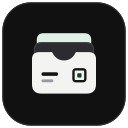
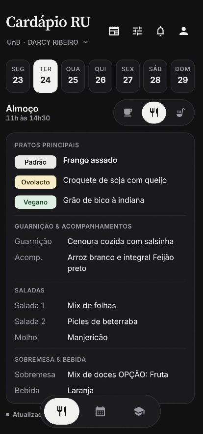
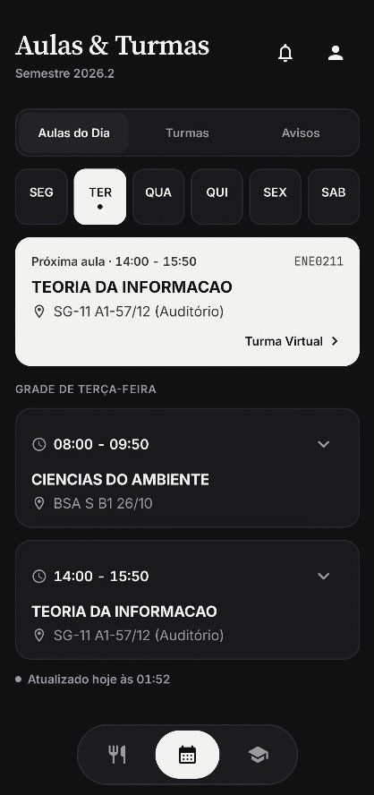
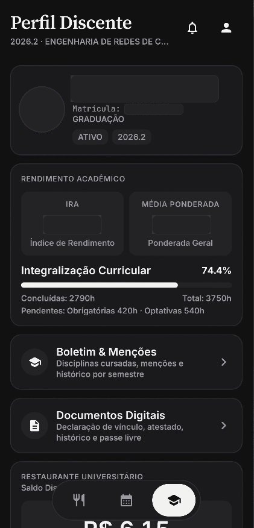

<div align="center">
  
  <h1>UnB Pocket</h1>
  <p>
    Cardapio do RU, horarios de aulas, Turma Virtual, saldo e QR Code da catraca da Universidade de Brasilia em um unico aplicativo rapido e offline-first para Android e iPhone (PWA).
  </p>
  <p>
    <a href="https://unb-pocket.pages.dev">
      
    </a>
    <a href="https://github.com/Cl0udShifter/unb-pocket/releases">
      
    </a>
    
    
    
    
  </p>
</div>

---

## Telas do aplicativo

<div align="center">
  <table>
    <tr>
      <td align="center"><strong>Cardapio RU</strong></td>
      <td align="center"><strong>Aulas &amp; Turmas</strong></td>
      <td align="center"><strong>Perfil Discente</strong></td>
    </tr>
    <tr>
      <td></td>
      <td></td>
      <td></td>
    </tr>
  </table>
</div>

---

## O que o app faz

### Cardapio do Restaurante Universitario (RU)
- Consulta o cardapio semanal de todos os campi da UnB: **Darcy Ribeiro**, **Ceilandia**, **Gama**, **Planaltina** e **Fazenda Agua Limpa**.
- **Filtro de alergenicos**: marque restricoes alimentares (gluten, leite, ovo, soja, amendoim, entre outros) para destacar ou ocultar pratos automaticamente.
- **Portal do RU**: acesso rapido aos avisos oficiais e a tabela de precos por grupo.
- **Notificacoes personalizadas**: escolha em quais dias da semana e refeicoes (cafe, almoco e jantar) quer receber um aviso 1 hora antes, abrindo o app direto no dia e turno certos.

### Aulas & Turmas
- Grade de horarios da semana e lista completa das turmas matriculadas no semestre.
- Acesso a **Turma Virtual**: topicos de aula, materiais para download, noticias, frequencia, notas parciais, avaliacoes e tarefas.
- Lembretes configuraveis de aulas, provas, entregas, notas e risco de falta.

### Perfil Discente & Catraca do RU
- Resumo academico com **IRA**, **Media Ponderada** e progresso de **integralizacao curricular**.
- **Saldo e extrato do RU** com estimativa de refeicoes restantes conforme seu grupo de acesso.
- **Passe QR da catraca em tela cheia**: toque para girar a tela com o QR Code centralizado em fundo branco e brilho maximo automatico; toque novamente para voltar.
- Consulta ao **Boletim** e emissao de **documentos oficiais** (declaracao de vinculo, atestado de matricula e historico).

### Pensado para o dia a dia
- **Offline-first**: cardapio, horarios, perfil, saldo e QR Code ficam salvos localmente para consulta mesmo sem internet.
- **Temas**: suporte a modo **Claro**, **Escuro** ou **Sistema**.

---

## Como instalar

### Android (APK Nativo)
1. Acesse a pagina de [Releases](https://github.com/Cl0udShifter/unb-pocket/releases) e baixe o arquivo `.apk` da versao mais recente.
2. Abra o arquivo no celular Android (versao 8.0 ou superior).
3. Caso o Android solicite, autorize a instalacao de aplicativos dessa fonte e conclua a instalacao.

### iOS (iPhone / iPad) e Web (PWA)
1. Acesse **[https://unb-pocket.pages.dev](https://unb-pocket.pages.dev)** direto no **Safari** do iPhone ou iPad (iOS 16.4 ou superior), sem precisar compilar ou baixar nada externo.
2. Toque no botao **Compartilhar** na barra do Safari (ou siga o guia exibido na abertura da pagina) e selecione **Adicionar a Tela de Inicio**.
3. Confirme em **Adicionar** para usar em tela cheia com cache offline, cofre criptografado Web Crypto (AES-GCM), leitor integrado de documentos e exportacao de alarmes `.ics` para o Calendario da Apple.

> O cardapio do RU funciona sem login. Para acessar turmas, saldo do RU, boletim e QR Code da catraca, entre com sua matricula e senha do SIGAA/CAS dentro do app.

---

## Privacidade e seguranca

- **Sem servidor intermediario**: o aplicativo se comunica diretamente com os portais oficiais da UnB (RU, CAS e SIGAA). Nenhum dado seu passa por servidores de terceiros.
- **Credenciais criptografadas no dispositivo**: se voce optar por manter o login salvo, a senha e protegida localmente pelo Android Keystore (AES-GCM) e removida ao desconectar.
- **Modo estritamente somente leitura**: o app possui uma camada de protecao que bloqueia qualquer requisicao mutavel no SIGAA (como trancamento, retirada de matricula, postagens em forum ou alteracao de perfil).

---

## Para desenvolvedores

O projeto segue arquitetura modular em Kotlin + Jetpack Compose, com separacao estrita entre dominio/dados e UI:

```text
app/            Camada Android e UI em Jetpack Compose (consome apenas :core:model)
core/model/     Modelos imutaveis, CoreError, CoreResult e contrato publico do Core
core/network/   Cliente OkHttp, cookies em memoria, lock JSF ViewState e guard-rail Read-Only
core/parser/    Parsers HTML/PDF do SIGAA e RU, horarios e classificador de alergenicos
core/data/      Room, DataStore, Keystore AES-GCM, WorkManager e agendadores de notificacao
docs/           Documentacao tecnica (core-contract.md e endpoints.md)
```

- Contrato entre Core e UI: [docs/core-contract.md](docs/core-contract.md)
- Diretrizes visuais: [DESIGN.md](DESIGN.md)

### Build e testes Android (JDK 17)

```bash
./gradlew :core:model:test :core:network:test :core:parser:test :core:data:testDebugUnitTest :app:testDebugUnitTest
./gradlew lint assembleDebug
```

### Build, testes e deploy do PWA (`pwa/`)

O subprojeto `pwa/` porta 1:1 o Core e a interface Monolito Editorial UnB para TypeScript + React 19 + Vite, acompanhado de uma Cloudflare Pages Function stateless (`pwa/functions/api/proxy.ts`) com o mesmo guard-rail Read-Only:

```bash
cd pwa
npm install
npm run dev
npm run typecheck && npm run lint && npm run test
npm run build
npm run test:e2e
```

---

## Aviso

Este e um projeto independente e open-source desenvolvido para facilitar a rotina academica de estudantes da UnB. Nao possui vinculo oficial com a Universidade de Brasilia (UnB), STI ou RU.
